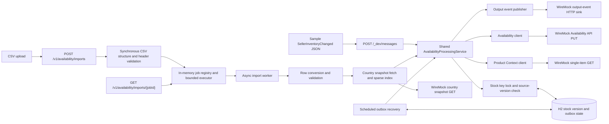
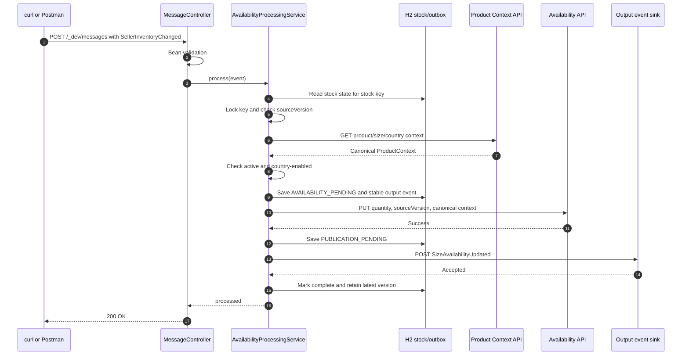
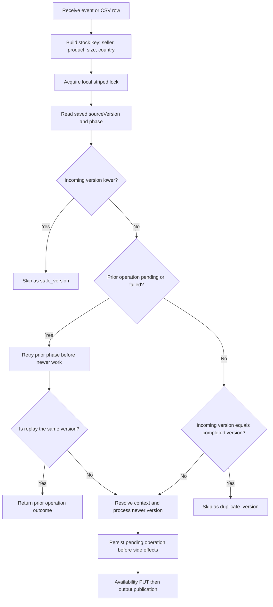
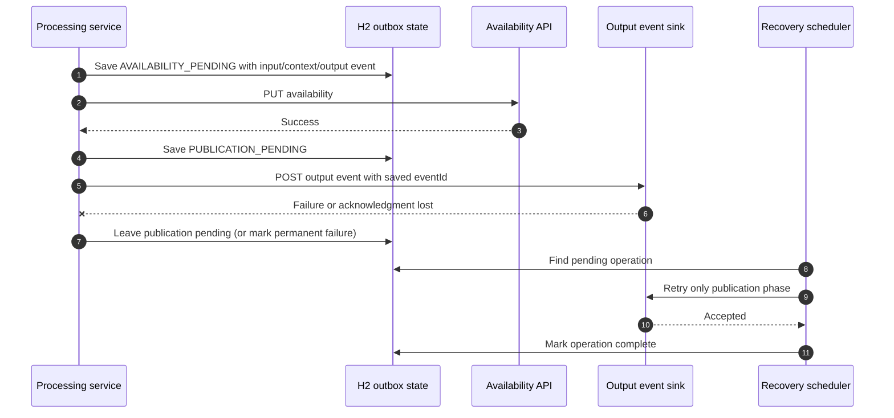
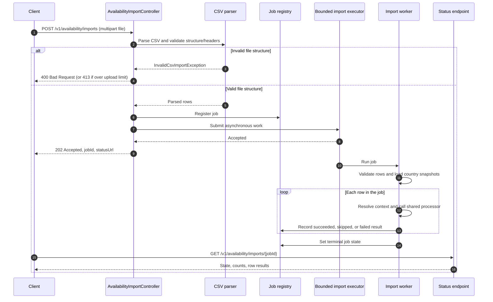
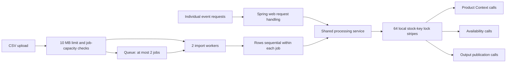
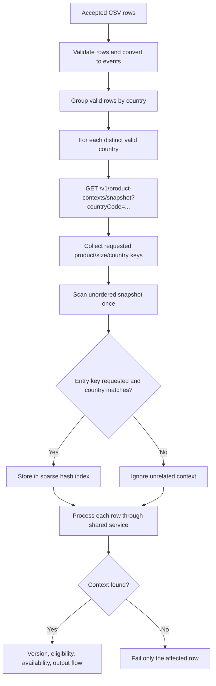
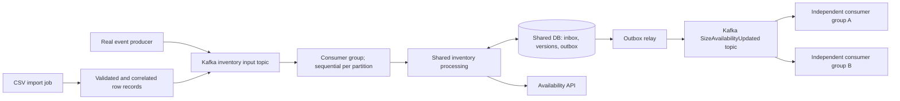

# Architecture and Requirement Coverage

This document maps the take-home exercise requirements to the implementation, explains the end-to-end flows, and records the use cases and current boundaries. It describes the repository as it is implemented; production improvements are called out separately. The scenario and APIs are hypothetical and do not describe internal Farfetch systems.

## 1. Scope and ownership

The application is a Java 21 / Spring Boot service. It owns the test-event ingress, CSV upload and job APIs, shared inventory processing, stock-version state, and recovery logic. WireMock supplies the Product Context API, Availability API, and output-event HTTP sink. There is no local broker and no production deployment requirement.

| Responsibility | Owner | Implementation |
|---|---|---|
| Test event ingress | This service | `POST /_dev/messages` |
| Bulk upload and job status | This service | `POST /v1/availability/imports`, `GET /v1/availability/imports/{jobId}` |
| Validation, ordering, enrichment, and downstream flow | This service | `AvailabilityProcessingService`, shared by both input paths |
| Single-item and snapshot Product Context APIs | Provided mock | WireMock mappings and included context fixtures |
| Availability updates | Provided mock | WireMock Availability API mapping |
| Output event recording | Provided mock | HTTP sink at `/mock-broker/v1/events`; not a real broker |
| Local stock/outbox state | This service | File-backed H2 database |
| Production message broker | Design recommendation only | Kafka; see [DECISIONS](DECISIONS.md) |

## 2. Full architecture

The diagram shows logical responsibilities, not a requirement to deploy separate services. Both input paths converge on the same business service. Bulk imports provide an already-resolved context through a snapshot-backed supplier; the single-event path uses the Product Context single-item endpoint.

## 3. Requirement-by-requirement coverage

| Assignment requirement | How the service handles it | Evidence / boundary |
|---|---|---|
| Java implementation and runnable local service | Java 21, Maven, Spring Boot; defaults to port `5000`; `GET /health` is available. | [Run-Instructions](Run-Instructions.md), `pom.xml`, `application.properties` |
| Keep provided components separate from the solution | WireMock runs separately on port `8080`; it supplies product context, availability, and the output sink. | `compose.yaml`, `wiremock/mappings/`, [README](README.md) |
| Test-only input event API | `POST /_dev/messages` accepts a validated `SellerInventoryChanged` JSON body and calls the shared processing service. | `MessageController`, `MessageControllerTest` |
| Single-event business flow | Check event type/schema and stock version, fetch product context, reject ineligible context, persist pending state, PUT availability, then publish the normalized output event. | `AvailabilityProcessingServiceTest`, `ProductContextClientTest` |
| Product Context identity | Context lookup uses `(productId, sizeId, countryCode)`; seller and quantity remain from the input. | `ProductContextSnapshotIndex`, `ProductContextClient` |
| Unknown/inactive/country-disabled context | A single-item `404` becomes a product-context-not-available error; inactive or country-disabled contexts are rejected. The request returns `422` and does not proceed to availability or publication. | `ProductContextClient`, `AvailabilityProcessingServiceTest` |
| Availability request and normalized output | The PUT includes `availableQuantity`, `sourceVersion`, and canonical context. The output identifies seller/product/size/country, quantity/version, and the canonical context. | `AvailabilityClient`, `OutputEventPublisher`, `AvailabilityProcessingService` |
| Asynchronous bulk upload | CSV structure is checked synchronously; an accepted upload returns `202` and a job ID while bounded workers process rows in the background. | `AvailabilityImportControllerTest`, `CsvImportServiceTest` |
| CSV schema and synchronous rejection | The required columns are checked regardless of order. Empty, malformed, header-only, duplicate-header, missing-header, or inconsistent-column files are rejected before acceptance. | `CsvImportFileParser`, `CsvImportServiceTest` |
| Job status and partial failures | The status response includes state, total/processed/succeeded/skipped/failed counts, an optional job-level error, and row results with record number, status, reason, or message. | `CsvImportJob`, `ImportJobStatusResponse`, `AvailabilityImportControllerTest` |
| Shared rules across event and CSV paths | Both paths call `AvailabilityProcessingService`, which applies the same version gate, eligibility rules, availability write, and publication/outbox flow. | `CsvImportService`, `AvailabilityProcessingServiceTest` |
| Bulk country snapshots | The importer fetches one snapshot per distinct valid country in a job, not one single-item GET per row. Snapshot order is irrelevant because entries are indexed by a composite key. | `CsvImportServiceTest`, `ProductContextSnapshotIndex` |
| Seller-specific version streams | `StockKey` includes seller, product, size, and country; the Product Context key omits seller. | `StockKey`, `ProductContextSnapshotIndex` |
| Stale and duplicate protection | Lower versions are skipped. A completed equal version is skipped as a duplicate. Pending earlier work is finished before a later version can proceed. | `AvailabilityProcessingServiceTest`, `AvailabilityProcessingConcurrencyTest` |
| Transient dependency faults | HTTP `429` and `503` are retried up to three total attempts, honoring `Retry-After` or using short exponential delays. | `DownstreamRetryExecutor`, client and processing tests |
| Partial downstream success | Durable phase state lets recovery resume an availability write or publication without losing the saved output event. | `JdbcStockVersionStoreTest`, `AvailabilityProcessingServiceTest`, [DECISIONS](DECISIONS.md) |
| Bursts and large imports | CSV work is bounded to two workers and two queued jobs; rows within a job are sequential; uploads are limited to 10 MB. | `AvailabilityImportExecutorConfiguration`, `application.properties` |
| Supplied deterministic scale fixture | The repository includes a 10,000-row CSV and 50,000-entry PT snapshot. The README and [DECISIONS](DECISIONS.md) explain matching complexity without a machine-specific timing target. | `wiremock/__files/bulk-stock.csv`, `wiremock/__files/product-contexts-PT.json` |
| Production broker choice | Kafka is recommended for the inventory event backbone, compared in depth with RabbitMQ, and kept separate from local WireMock execution. | [DECISIONS](DECISIONS.md) |
| Focused tests and operational instructions | Tests cover core flow, ordering, persistence, concurrency, retries, bulk validation, partial row outcomes, and controller contracts. Local commands and mock reset instructions are documented. | `src/test/java/`, [README](README.md), [Run-Instructions](Run-Instructions.md) |

## 4. Single-event feature

### Happy path

The inbound event is not sent to the output sink. The service builds a separate `SizeAvailabilityUpdated` event with a generated ID and canonical product context. The input event ID represents a delivery and may change on replay; business duplicate detection uses the stock key and `sourceVersion`, not that input ID.

### Event input and response behavior

The required input fields are `eventId`, `eventType`, `schemaVersion`, `occurredAt`, `sellerId`, `productId`, `sizeId`, `countryCode`, `availableQuantity`, and `sourceVersion`. Bean validation rejects blank identifiers, invalid country-code shape, null or negative quantities/versions, and invalid schema version. The processor supports `SellerInventoryChanged` schema version 1.

Country-code validation currently checks uppercase two-letter syntax (`[A-Z]{2}`); it does not independently check membership in the ISO 3166-1 alpha-2 registry. A syntactically valid code with no matching Product Context is rejected as unavailable (`422` for a single event and a row failure for CSV). Strict ISO-registry membership validation is a small hardening opportunity if the service must distinguish invalid codes from valid codes with no product context.

| Condition | Service behavior |
|---|---|
| Eligible new version | Context lookup, availability PUT, output publication; returns `200` with `processed`. |
| Lower version than saved | Returns `200` with `skipped` / `stale_version`; no context, PUT, or publication is needed. |
| Equal version already complete | Returns `200` with `skipped` / `duplicate_version`; no downstream calls. |
| Unknown context (`404`), inactive product, or country disabled | Returns `422`; no availability write or output event. |
| Invalid event or unsupported type/schema | Returns `400`. |
| Downstream request still failing after retry policy | Returns `502`; durable pending work remains recoverable where applicable. |

## 5. Version ordering and idempotency

- The ordering key is `(sellerId, productId, sizeId, countryCode)`. A version in another seller/product/size/country stream is independent.
- The same ordering rules apply whether the version arrived through `/_dev/messages` or a CSV row. A bulk import cannot override a newer event.
- The 64 striped locks serialize same-key work within this one service process. Stripe collisions can also serialize unrelated keys. They are bounded in memory but are not distributed locks.
- The H2 state stores the latest version and, while work is pending or failed, the input, canonical context, output event, and processing phase.
- The side effects are at-least-once. A repeated Availability PUT must be idempotent for the stock key/version. If an event publication is repeated after an uncertain acknowledgment, the same saved output event ID lets a consumer deduplicate.

## 6. Partial-success recovery and retries

The state transition is deliberately persisted between the two remote calls. When publication fails after a successful availability write, recovery retries publication rather than repeating the PUT. If the service crashes after the remote PUT succeeds but before `PUBLICATION_PENDING` is saved, the PUT can be repeated after restart; this is why the gateway operation must be idempotent.

`429` and `503` are retried immediately up to three total attempts. `Retry-After` accepts seconds or an HTTP date; otherwise the fallback is 100 ms then 200 ms. Exhausted `429`/`503` and transport errors remain pending for the recovery scheduler (initial delay 1 second, then a 5-second fixed delay by default). Other HTTP response errors are recorded as failed and are not polled automatically. An input replay, or a newer event for that stock key, attempts to resolve the earlier operation before advancing the stream.

The current retry implementation has no jitter, circuit breaker, or global downstream rate limiter. See [DECISIONS](DECISIONS.md) for alternatives and production improvements.

## 7. Asynchronous CSV import feature

### Job states and partial failure contract

| State or count | Meaning |
|---|---|
| `QUEUED` | Accepted and awaiting an import worker. |
| `PROCESSING` | A worker is handling rows. |
| `COMPLETED` | Every row received an outcome and none failed. Skipped rows are allowed. |
| `COMPLETED_WITH_ERRORS` | Every row received an outcome and at least one failed. |
| `FAILED` | An unexpected job-level error stopped processing before normal completion. |
| `totalRows` | Number of CSV data rows (header excluded). |
| `processedRows` | Rows with a recorded result; can be less than total if a job stops unexpectedly. |
| `succeededRows` | Rows processed successfully through the shared business flow. |
| `skippedRows` | Stale or duplicate versions; these are not failures. |
| `failedRows` | Invalid row values, missing/ineligible context, or downstream failure for that row's attempt. |

Each row result contains the CSV record number (header is record 1), `SUCCEEDED`, `SKIPPED`, or `FAILED`, and a reason or message when applicable. A downstream operation may later complete through outbox recovery even if its row was reported failed after immediate retries; the job status describes the attempt made by that job and is not retroactively rewritten by recovery.

### Synchronous versus asynchronous validation

Synchronous checks cover the file's existence, upload size, CSV syntax and row shape, duplicate/missing/blank header names, required columns, and the presence of at least one data row. This allows malformed requests to fail before returning `202`.

Once accepted, each row is converted to the event contract and validated. Invalid numeric values, negative quantities/versions, blank required fields, invalid country-code shape, missing context, or downstream failures become row-level failures; other rows continue. Stale and duplicate versions are skipped. A full worker/job capacity returns `503` and does not leave an unreachable job behind.

The executor has two active worker threads and capacity for two queued jobs. Rows within each job are sequential; two jobs may run concurrently. The file is parsed into in-memory rows before acceptance, is capped at 10 MB, and job status/results are in memory. The latest 20 jobs are retained, and status is lost on restart. Stock and outbox state remains in H2.

### Concurrency and backpressure

The bounded executor limits bulk fan-out, and same-key operations are serialized locally. Individual-event requests are not governed by a global admission limit, and the lock stripes do not impose a rate limit on downstream APIs. A production deployment should add shared/per-dependency concurrency permits and rate limiting across both input paths; the design options are in [DECISIONS](DECISIONS.md).

## 8. Snapshot matching feature

For each import, the service gathers distinct requested keys by valid country, fetches one snapshot for each country, and scans it once. It stores only entries matching requested keys. Since the snapshot is unordered, a hash index avoids dependence on response order. The context key is `(productId, sizeId, countryCode)`; seller identity is intentionally excluded.

Let `R_c` be valid rows for country `c`, `R = sum(R_c)`, `N_c` be snapshot entries for country `c`, and `M_c` be matching requested contexts retained by the index. Expected matching time is `O(R + sum(N_c))`; each hash lookup is expected `O(1)`. Per-job row/job state is `O(R)`, retained context indexes are `O(sum(M_c))`, and the largest materialized country snapshot contributes `O(max(N_c))` temporary memory. The overall per-job working set is therefore `O(R + sum(M_c) + max(N_c))`; two simultaneous jobs can approximately double it.

For the supplied one-country fixture, the service scans 50,000 contexts once for 10,000 rows, instead of making 10,000 single-item context calls or performing about 500 million comparisons. No machine-specific elapsed-time threshold is part of the exercise. A successful row still needs one Availability PUT and one output POST; those network calls remain the throughput constraint.

If a snapshot request fails after the retry policy, valid rows for that country fail, while rows from other countries may continue. A missing context fails only matching rows. The snapshot is consistent for the duration of a job; later changes are not visible to that import.

## 9. Use-case and edge-case matrix

| Feature | Input or condition | Expected outcome |
|---|---|---|
| Single event | New version and eligible product | One context lookup, one Availability PUT, one output event; response is `processed`. |
| Input validation | Missing required field, invalid country format, negative quantity/version | `400`; no downstream calls. |
| Contract version | Unsupported event type or schema version | `400`; no downstream calls. |
| Product Context | Unknown product/size/country (`404`) | `422`; no Availability PUT or output event. |
| Product Context | Inactive or country-disabled context | `422`; no Availability PUT or output event. |
| Version ordering | Incoming version lower than saved | `stale_version`; no write or publication. |
| Version idempotency | Same completed version, even if replayed with another input event ID | `duplicate_version`; no write or publication. |
| Independent streams | Same product/size/country but another seller | Version is independent and can be processed. |
| Concurrent same-key updates | Two event/import paths race for one stock key | Local striped lock serializes them; version comparison prevents stale overwrite. |
| Product Context transient fault | `429` with `Retry-After` or `503` | Up to three attempts; exhausted failure maps to `502` for single event, or a failed row for an import. |
| Availability transient fault | `429` or `503` | Up to three attempts; pending operation can be resumed by recovery. |
| Output sink transient fault | `429` or `503` after Availability succeeds | Publication remains pending; recovery retries with the saved event, not the Availability PUT. |
| Permanent downstream write/publish failure | A non-`429`/`503` response from the Availability PUT or output publication | The durable operation is marked failed; no scheduled polling. Replay after correction or a newer event attempts to resolve it first. Product Context `404` is instead mapped to `422` before an outbox operation is created. |
| Uncertain remote acknowledgment | Remote operation may have succeeded but response was lost | A retry can repeat the call; PUT idempotency and consumer deduplication by stable output event ID are required. |
| CSV happy path | Well-formed rows with available contexts and newer versions | `202`, then row-level success; each successful row gets PUT and output event. |
| CSV structural failure | Empty, malformed, header-only, missing/duplicate headers, inconsistent columns | Synchronous `400`; no job is accepted. |
| CSV row validation failure | Invalid field values in a structurally valid file | Only that row fails; remaining rows continue. |
| CSV stale/duplicate row | Version is behind or already completed for that stock key | Row is `SKIPPED`, increments `skippedRows`, not `failedRows`. |
| CSV missing context | Snapshot lacks requested row key | Only that row fails. |
| CSV snapshot failure | Snapshot call fails for a country | Valid rows for that country fail; other countries continue. |
| CSV mixed results | Successes, skips, and failures in one job | Job reaches `COMPLETED_WITH_ERRORS`; counts and row results describe each outcome. |
| CSV overload | Two workers and two queued jobs are occupied, or retained-job capacity cannot be freed | `503`; upload is not accepted. |
| CSV too large | File or request exceeds 10 MB | `413`; no job is accepted. |
| Job status | Unknown or evicted `jobId` | `404`. |
| Process restart | Application restarts during/after import | Job status/results are lost; H2 stock/outbox state remains and pending business operations can recover. |
| Deterministic fixtures | 10,000 rows and 50,000 PT contexts | Ready-to-use fixtures; one snapshot scan per valid country, no data generation step. |

The deterministic Product Context/Availability fault inputs are listed in the [README](README.md). The event-sink fixed-ID fixtures can be called directly; the application generates UUID output IDs, so they do not trigger those exact mappings through normal app-generated output. Publisher retry behavior is covered in automated tests, and a temporary path-only sink mapping is documented for end-to-end recovery testing in [DECISIONS](DECISIONS.md).

## 10. Decision record and alternatives

| Decision | Chosen approach | Alternative and trade-off |
|---|---|---|
| Business flow reuse | One `AvailabilityProcessingService` for events and CSV rows. | Duplicate event and bulk implementations would be simpler initially but can drift in validation, ordering, and failure handling. |
| Bulk context lookup | One snapshot per valid country and a sparse hash index. | Per-row GET adds network round trips; repeated snapshot scans cost `O(R_c * N_c)`; a full snapshot index retains unused contexts. |
| Stock concurrency | 64 striped local locks and persisted version state. | One lock per key uses more memory; database/distributed locking is required for multiple service instances. |
| Partial success | Persist state between Availability PUT and event publication; recover the pending phase. | A single sequential flow can lose the event after a successful PUT; a distributed transaction across HTTP services is unavailable. |
| Retry scope | Retry only `429`/`503`, honor `Retry-After`, and cap immediate attempts. | Retrying all errors wastes load on permanent failures; unlimited retries can occupy workers and amplify an outage. |
| Import admission | Fixed two-worker executor, two-job queue, 10 MB limit. | Unbounded threads/queues risk memory and dependency overload; a durable external queue is more complex but survives restart. |
| Job status | In-memory latest-20 registry for the exercise. | Persisted jobs/results survive restart and scale horizontally, but require a schema, retention policy, and transactional job updates. |
| Local persistence | File-backed H2 for one local instance. | PostgreSQL or another shared database is appropriate for a production multi-instance service. |
| Broker | Kafka is the recommended production backbone for replay and independent consumer groups. | RabbitMQ is strong for queue/routing workflows but less natural for replaying a retained inventory event log. Neither runs locally in this solution. |

### Recommended Kafka integration (production only)

In this proposed production topology, CSV rows and real inbound events converge on the same input topic and processing rules. The record key is the full stock key, so independent partitions can progress concurrently while one key remains ordered. The database inbox/outbox bridges Kafka and the external HTTP gateway; output events are published from the outbox to a separate topic. Kafka is not part of the current application runtime. The adapter, partition strategy, offset/commit policy, and operational responsibilities are detailed in [DECISIONS](DECISIONS.md#production-broker-choice).

The fuller retry, recovery, broker, and complexity rationale is in [DECISIONS](DECISIONS.md). Future production work is prioritized there.

## 11. Test and manual-verification map

| Test file | Coverage focus |
|---|---|
| `HealthControllerTest` | Application health endpoint. |
| `MessageControllerTest` | Test ingress request/response behavior. |
| `ProductContextClientTest` | Single lookup and context client behavior. |
| `AvailabilityProcessingServiceTest` | Business flow, version handling, eligibility, downstream failure, and recovery semantics. |
| `AvailabilityProcessingConcurrencyTest` | Concurrent same-key processing and ordering. |
| `JdbcStockVersionStoreTest` | H2 persistence and state across store recreation. |
| `AvailabilityImportControllerTest` | Upload/status HTTP contracts and request errors. |
| `CsvImportServiceTest` | Async job outcomes, snapshots, row failures, stale/duplicate rows, malformed CSV, queue and retention behavior. |

Run the focused/full verification from the repository root with `mvn verify`. The README and [DECISIONS](DECISIONS.md) give the Postman sequence, mock-journal checks, deterministic fault inputs, recovery exercise, and full-fixture upload. The 10,000-row fixture was previously exercised against WireMock: one PT snapshot GET, 10,000 availability PUTs, and 10,000 output-event POSTs. This is request-count evidence, not a timing guarantee.

## 12. Current limitations and production improvements

| Current boundary | Why it is acceptable here | Production improvement |
|---|---|---|
| One local H2 database and process-local striped locks | Simple, reproducible local exercise setup. | Shared relational database, transactional outbox, and database/advisory locking or optimistic concurrency for multiple instances. |
| In-memory import job status, maximum 20 retained jobs | Keeps the exercise self-contained. | Persist job state and row results; define retention, access control, and recovery semantics. |
| Entire CSV parsed into memory; 10 MB cap | Adequate for the supplied deterministic fixture. | Streaming/chunked parsing and durable staging for larger uploads. |
| Two import workers and per-job sequential rows | Provides bounded fan-out with simple ordering. | Tune worker counts from measured downstream capacity; use bounded per-dependency bulkheads and rate limiters. |
| Country code is checked for uppercase two-letter syntax only | The provided fixtures use supported country codes, and unknown Product Context is rejected. | Validate full ISO 3166-1 alpha-2 membership when the service must distinguish invalid codes from valid codes with no context. |
| No global limit on single-event HTTP ingress | The exercise focuses on correctness and bounded bulk processing, not production traffic management. | Apply admission control and rate limits across all ingress paths and service instances. |
| Retry backoff has no jitter or circuit breaker | Small bounded retry policy is easy to inspect and test. | Add jitter, circuit breakers, retry budgets, and per-dependency concurrency caps to reduce retry storms. |
| HTTP sink instead of real broker | A real broker is explicitly not required locally. | Implement a broker adapter and outbox relay; for Kafka, partition by the stock key and deduplicate by output event ID. |
| Limited production observability/security | Local mocks are intentionally unauthenticated and bound to localhost. | Add authentication/authorization, audit controls, structured business metrics, distributed tracing, alerting, and secrets management. |

For the security of local setup, keep WireMock's unauthenticated admin API bound to `127.0.0.1`; do not expose it to a network.
